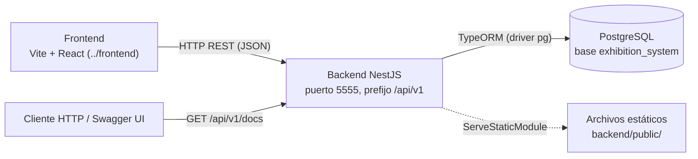
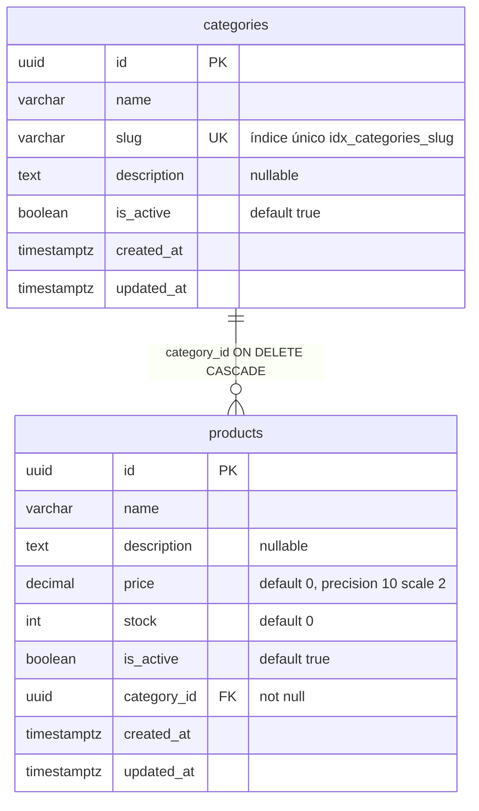
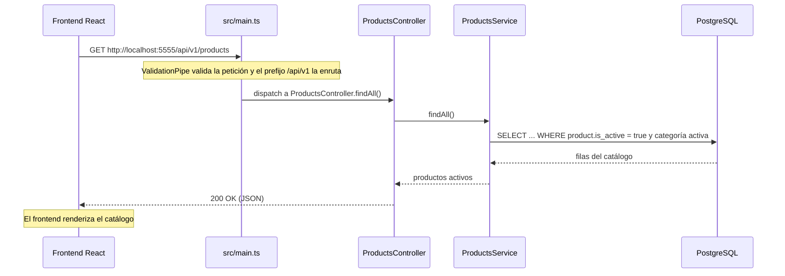

# Sistema de Exposiciones — Backend

API REST del sistema de exposiciones: sirve el catálogo de **categorías** y **productos** (CRUD completo con validación, soft delete y siembra de datos de prueba) que consume el frontend React de este mismo repositorio, documentada interactivamente con Swagger.

## Tabla de contenidos

- [1. Descripción general](#1-descripción-general)
- [2. Stack tecnológico](#2-stack-tecnológico)
- [3. Arquitectura y estructura del proyecto](#3-arquitectura-y-estructura-del-proyecto)
- [4. Requisitos previos](#4-requisitos-previos)
- [5. Instalación](#5-instalación)
- [6. Configuración del entorno](#6-configuración-del-entorno)
- [7. Ejecución en desarrollo](#7-ejecución-en-desarrollo)
- [8. Ejecución en producción](#8-ejecución-en-producción)
- [9. Pruebas (Testing)](#9-pruebas-testing)
- [10. Linting y formateo](#10-linting-y-formateo)
- [11. API / Interfaces públicas](#11-api--interfaces-públicas)
- [12. Modelo de datos](#12-modelo-de-datos)
- [13. Flujo principal (Happy path)](#13-flujo-principal-happy-path)
- [14. Decisiones de arquitectura relevantes](#14-decisiones-de-arquitectura-relevantes)
- [15. Solución de problemas comunes](#15-solución-de-problemas-comunes)
- [16. Licencia](#16-licencia)

## 1. Descripción general

Este proyecto es el **backend** de un sistema de exposiciones (el frontend vive en `../frontend/`, con Vite + React). Su propósito es exponer un catálogo de productos agrupados en categorías mediante una API REST bajo el prefijo `/api/v1`, persistiendo en PostgreSQL con TypeORM. Lo usa quien necesita poblar, consultar y mantener el catálogo que la aplicación web exhibe: es un proyecto académico (SENA) con arquitectura de monolito modular.

Además de la API, sirve archivos estáticos desde `backend/public/` y ejecuta un endpoint de seeders que resetea y siembra la base de datos con datos de prueba.



## 2. Stack tecnológico

Todas las versiones proceden de `package.json` y de los paquetes instalados en `node_modules/` (resolución de `pnpm-lock.yaml`, lockfileVersion 9.0).

| Capa | Tecnología | Versión | Propósito |
|---|---|---|---|
| Runtime | Node.js | Sin fijar (no hay `engines` ni `.nvmrc`) | Ejecutar el servidor |
| Framework | NestJS (`@nestjs/core`, `@nestjs/common`) | 12.1.3 | Estructura de la API, DI, pipes, CORS |
| Lenguaje | TypeScript | 6.0.3 | Tipado estático (`strict`, target ES2023) |
| ORM | TypeORM + `@nestjs/typeorm` | 1.1.2 / 12.0.2 | Mapeo objeto-relacional y entidades |
| Base de datos | PostgreSQL (driver `pg`) | driver 8.23.1 | Persistencia (versión del servidor no fijada en el repo) |
| Configuración | `@nestjs/config` | 12.0.1 | Lectura global de variables de entorno |
| Validación | `class-validator` + `class-transformer` | 0.15.1 / 0.5.1 | Validación de DTOs con `ValidationPipe` |
| Documentación API | `@nestjs/swagger` | 12.0.2 | Swagger UI en `/api/v1/docs` |
| Estáticos | `@nestjs/serve-static` | 12.0.0 | Sirve `backend/public/` en la raíz |
| Observabilidad | `@nestjs/observe` | 0.3.10 | Instrumentación (claves placeholder sin configurar) |
| Reacciones | `rxjs` | 7.8.2 | Primitivas reactivas de NestJS |
| Utilidades | `bcryptjs`, `uuid`, `reflect-metadata` | 3.0.3 / 14.0.3 / 0.2.2 | Declaradas en `package.json`; `bcryptjs` y `uuid` **no se importan** en `src/` |
| Pruebas | `vitest`, `@vitest/coverage-v8`, `supertest` | 4.1.12 / 4.1.12 / 7.3.1 | Tests unitarios, e2e y cobertura |
| Lint | `oxlint` | 1.88.0 | Análisis estático type-aware |
| Formato | `prettier` | 3.9.10 | Formato de código |
| CLI | `@nestjs/cli` | 12.0.8 | `nest build`, `nest start`, `nest deploy` |
| Gestor de paquetes | pnpm | lockfile 9.0 | Único gestor permitido en el proyecto |

## 3. Arquitectura y estructura del proyecto

Patrón: **monolito modular** (NestJS). Cada dominio de negocio es un módulo NestJS con su tríada `controller → service → entity`, y `AppModule` compone los módulos junto con la configuración transversal (TypeORM, Config, estáticos, observabilidad).

```text
backend/
├── src/
│   ├── main.ts                 # Bootstrap: puerto, prefijo global, CORS, ValidationPipe, Swagger
│   ├── app.module.ts           # Módulo raíz: TypeORM, ConfigModule, ServeStatic, Observe
│   ├── categories/             # Dominio categorías
│   │   ├── categories.controller.ts   # Rutas HTTP /api/v1/categories
│   │   ├── categories.service.ts      # Lógica de negocio (QueryBuilder, slug, soft delete)
│   │   ├── categories.module.ts
│   │   ├── dto/                # create-category.dto.ts, update-category.dto.ts
│   │   └── entities/category.entity.ts
│   ├── products/               # Dominio productos (misma estructura)
│   │   ├── products.controller.ts
│   │   ├── products.service.ts
│   │   ├── products.module.ts
│   │   ├── dto/                # create-product.dto.ts, update-product.dto.ts
│   │   └── entities/product.entity.ts
│   └── seeders/                # Reset + siembra de la BD (solo desarrollo)
│       ├── seeders.controller.ts
│       ├── seeders.service.ts
│       └── seeders.module.ts
├── public/                     # Estáticos servidos por ServeStaticModule (index.html)
├── dist/                       # Build generado por `nest build`
├── package.json                # Scripts y dependencias (type: module)
├── pnpm-lock.yaml              # Lockfile pnpm (v9.0)
├── nest-cli.json               # sourceRoot: src, spec: false en generadores
├── tsconfig.json               # moduleResolution: nodenext, strict
├── vitest.config.ts            # Tests unitarios: **/*.spec.ts
├── vitest.config.e2e.ts        # Tests e2e: **/*.e2e-spec.ts
├── .oxlintrc.json              # Reglas lint (no-floating-promises: error)
├── .prettierrc                 # singleQuote, trailingComma: all
├── .env                        # Configuración real (NO commitear)
├── .env.template               # Plantilla de variables
├── README.md                   # Este documento
└── README.old.md               # Respaldo del README anterior (plantilla NestJS)
```

> [!IMPORTANT]
> Es un proyecto **ESM estricto** (`"type": "module"` en `package.json`, `moduleResolution: "nodenext"`): todos los imports relativos llevan extensión `.js` aunque el archivo sea `.ts` (por ejemplo, `import { AppModule } from './app.module.js'`).

## 4. Requisitos previos

| Requisito | Detalle |
|---|---|
| Node.js | El repo **no fija versión** (no hay `.nvmrc`, `.tool-versions` ni campo `engines`). Los comandos de este README se verificaron con Node v26.10.0. |
| pnpm | Obligatorio (`pnpm-lock.yaml`; npm/y están prohibidos por `AGENTS.md`). Verificado con pnpm 12.9.1. |
| PostgreSQL | Servidor accesible en `localhost:5432` por defecto (ver `DB_*` en `.env`). La versión del servidor no está fijada en el repo. |
| Sistema | No hay dependencias de sistema declaradas ni `Dockerfile`/`docker-compose` en el repo. |

## 5. Instalación

Desde la raíz del repositorio (remoto: `https://github.com/esteban5tael/proyecto-para-mostrar-sena.git`):

```bash
git clone https://github.com/esteban5tael/proyecto-para-mostrar-sena.git
cd proyecto-para-mostrar-sena/backend

# Instalar dependencias (pnpm es el único gestor permitido)
pnpm install

# Crear el .env a partir de la plantilla
cp .env.template .env
```

No hay paso de build previo obligatorio: `pnpm dev` compila y arranca en modo watch.

## 6. Configuración del entorno

Variables leídas vía `ConfigService` (`@nestjs/config`, global) o `process.env`. Plantilla: `backend/.env.template`; valores reales: `backend/.env` (este último no debe commitearse).

| Variable | Obligatoria | Valor por defecto | Descripción | Dónde se usa (archivo) |
|---|---|---|---|---|
| `PORT` | No | `3000` (fallback en código); plantilla `3000`; `.env` real `5555` | Puerto HTTP del servidor | `src/main.ts` |
| `API_PREFIX` | No | `api/v1` (fallback en código); plantilla `/api/v1` | Prefijo global de todas las rutas | `src/main.ts` |
| `DB_TYPE` | No | `postgres` | Tipo de base de datos para TypeORM | `src/app.module.ts` |
| `DB_HOST` | No | `localhost` | Host de PostgreSQL | `src/app.module.ts` |
| `DB_PORT` | No | `5432` | Puerto de PostgreSQL | `src/app.module.ts` |
| `DB_USER` | No | `postgres` | Usuario de PostgreSQL | `src/app.module.ts` |
| `DB_PASSWORD` | No | `postgres` | Contraseña de PostgreSQL | `src/app.module.ts` |
| `DB_NAME` | No | `exhibition_system` | Nombre de la base de datos | `src/app.module.ts` |
| `BCRYPT_SALT` | No | `10` (plantilla) | Declarada pero **sin uso**: no hay código que la lea ni imports de `bcryptjs` en `src/` | — (solo `.env*`) |
| `JWT_SECRET` | No | `SECRET` (plantilla) | Declarada pero **sin uso**: no hay autenticación JWT en el proyecto | — (solo `.env*`) |
| `NODE_ENV` | No | `development` (fallback en código) | Solo se usa para el log de arranque; no está en `.env` | `src/main.ts` |

> [!NOTE]
> `BCRYPT_SALT` y `JWT_SECRET` son residuales: existen en `.env`/`.env.template`, pero ningún archivo de `src/` los lee (verificado con grep) y no hay módulo de autenticación.

## 7. Ejecución en desarrollo

Todos los comandos se ejecutan **dentro de `backend/`**. Cada comando corresponde literalmente al bloque `scripts` de `package.json`:

| Comando | Script | Qué hace (leído del script) |
|---|---|---|
| `pnpm dev` | `nest start --watch` | Compila, arranca y relanza ante cambios — **recomendado** |
| `pnpm start:dev` | `nest start --watch` | Alias idéntico de `pnpm dev` |
| `pnpm start` | `nest start` | Compila y arranca una vez (sin watch) |
| `pnpm start:debug` | `nest start --debug --watch` | Arranque en watch con inspector de Node activado |
| `pnpm format` | `prettier --write "src/**/*.ts" "test/**/*.ts"` | Reformatea el código fuente |
| `pnpm lint` | `oxlint --type-aware src/ test/` | Análisis estático type-aware |
| `pnpm deploy` | `nest deploy` | Despliegue a la nube vía Mau (según `nest --help`: «Deploy your application to the cloud (powered by Mau)») |

```bash
cd backend
pnpm dev
# Application is running on: http://localhost:5555/api/v1
# Swagger UI: http://localhost:5555/api/v1/docs
```

El arranque también loguea la URL de Swagger y el `NODE_ENV` efectivo (ver `src/main.ts`). CORS está abierto con `origin: '*'`.

## 8. Ejecución en producción

```bash
pnpm build        # nest build → genera dist/
pnpm start:prod   # node dist/main
```

- No existe `Dockerfile`, `docker-compose.yml` ni ningún archivo de despliegue en el repo (verificado en la raíz y en `backend/`).
- `pnpm deploy` (→ `nest deploy`, Mau) es el único comando de despliegue declarado en `package.json`.
- El servidor sirve además `backend/public/` en la raíz del sitio mediante `ServeStaticModule` (`src/app.module.ts`), donde vive un `index.html`.

> [!WARNING]
> TypeORM se configura con `synchronize: true` y `autoLoadEntities: true` (`src/app.module.ts`): **el esquema se auto-genera/altera en cada arranque y no hay migraciones**. No apuntes este arranque contra una base de datos con datos valiosos sin revisarlo.

> [!IMPORTANT]
> El endpoint de seeders (`POST /api/v1/seeders`) ejecuta `TRUNCATE ... CASCADE` y **borra todo el contenido** de las tablas. Es de solo desarrollo (su propio código lo advierte); no debe exponerse en producción, donde además no hay autenticación que lo proteja.

## 9. Pruebas (Testing)

Framework: **Vitest 4.1.12** (configs `vitest.config.ts` y `vitest.config.e2e.ts`, con `globals: true`).

| Comando | Script | Alcance |
|---|---|---|
| `pnpm test` | `vitest run` | Unitarios: archivos `**/*.spec.ts` |
| `pnpm test:watch` | `vitest` | Unitarios en modo watch |
| `pnpm test:cov` | `vitest run --coverage` | Cobertura (v8, `@vitest/coverage-v8`) |
| `pnpm test:debug` | `vitest --inspect-brk --no-file-parallelism` | Depuración de tests |
| `pnpm test:e2e` | `vitest run --config ./vitest.config.e2e.ts` | E2E: archivos `**/*.e2e-spec.ts` |

> [!NOTE]
> **Hoy no existe ningún archivo de test**: `find backend -name "*.spec.ts"` y `find backend -name "*.e2e-spec.ts"` no devuelven nada, y no hay carpeta `test/`. Por eso `pnpm test` termina con «No test files found, exiting with code 1» y `pnpm test:e2e` falla igual. Los scripts y las configs están listos; falta escribir los tests (el scaffold de NestJS los desactiva: `nest-cli.json` tiene `"spec": false`).

`supertest` (7.3.1) ya está instalado como `devDependency` para cuando se añadan tests e2e.

## 10. Linting y formateo

| Herramienta | Configuración | Comando |
|---|---|---|
| `oxlint` 1.88.0 (type-aware) | `.oxlintrc.json` — `typescript/no-floating-promises: error`, `typescript/no-explicit-any: off`, `env.node: true` | `pnpm lint` |
| `prettier` 3.9.10 | `.prettierrc` — `singleQuote: true`, `trailingComma: all` | `pnpm format` |

Estado verificado: `pnpm lint` termina sin errores, mostrando 2 warnings actuales (`no-unused-vars` en `products.controller.ts` y `no-misused-spread` en `categories.service.ts`). El objetivo `test/` del script no existe hoy, lo que oxlint tolera.

## 11. API / Interfaces públicas

Base: `http://localhost:{PORT}/{API_PREFIX}` → por defecto `http://localhost:5555/api/v1` con el `.env` del repo. **No hay autenticación en ningún endpoint** (no existen guards ni módulo JWT en `src/`).

Documentación interactiva: **Swagger UI** en `GET /api/v1/docs` (montado en `src/main.ts` con `useGlobalPrefix: true`).

| Método | Ruta (bajo `/api/v1`) | Auth | Descripción |
|---|---|---|---|
| `POST` | `/categories` | Ninguna | Crear categoría (201; `name` y `slug` únicos) |
| `GET` | `/categories` | Ninguna | Listar todas las categorías con sus productos (QueryBuilder; `eager` de la relación) |
| `GET` | `/categories/:id` | Ninguna | Obtener categoría por UUID v4 (400 si el id no es UUID v4; 404 si no existe) |
| `GET` | `/categories/slug/:slug` | Ninguna | Obtener categoría activa por slug, con productos activos |
| `PATCH` | `/categories/:id` | Ninguna | Actualizar categoría parcialmente |
| `DELETE` | `/categories/:id` | Ninguna | Desactivar categoría (soft delete, responde **204**) |
| `POST` | `/products` | Ninguna | Crear producto; `categoryId` debe apuntar a una categoría activa |
| `GET` | `/products` | Ninguna | Listar productos activos cuya categoría también esté activa |
| `GET` | `/products/:id` | Ninguna | Obtener producto por UUID v4 (sin filtrar `isActive`, permite ver desactivados) |
| `PATCH` | `/products/:id` | Ninguna | Actualizar producto (incluye reactivar con `isActive: true`) |
| `DELETE` | `/products/:id` | Ninguna | Desactivar producto (soft delete → `{ id, deleted: true }`) |
| `POST` | `/seeders` | Ninguna | **Resetear y sembrar la BD**: 5 categorías × 5 productos (201) |

Rutas no-API: `GET /` sirve `backend/public/index.html` (`ServeStaticModule`).

## 12. Modelo de datos

TypeORM genera el esquema con `synchronize: true` (sin migraciones) a partir de dos entidades:

| Tabla | Entidad | Relación |
|---|---|---|
| `categories` | `src/categories/entities/category.entity.ts` | 1 → N con `products` (`eager: true` en `products`) |
| `products` | `src/products/entities/product.entity.ts` | N → 1 con `categories` (`FK category_id`, `onDelete: 'CASCADE'`) |



Detalles verificados en las entidades: ids `uuid` generados por PostgreSQL; `slug` con índice único `idx_categories_slug`; ambos dominios usan soft delete (`is_active`) y marcas `created_at`/`updated_at` (`timestamptz`).

## 13. Flujo principal (Happy path)

Consulta del catálogo desde el frontend — participantes todos presentes en el código (`frontend/src/lib/constants.ts`, `src/main.ts`, `products.controller.ts`, `products.service.ts`, TypeORM en `app.module.ts`):



## 14. Decisiones de arquitectura relevantes

Todas verificables en el código citado:

- **ESM estricto**: `"type": "module"` + `moduleResolution: "nodenext"` → los imports relativos terminan en `.js` (ej. `import { AppModule } from './app.module.js'` en `src/main.ts`).
- **Sin migraciones**: `synchronize: true` + `autoLoadEntities: true` en `src/app.module.ts` — el esquema se auto-genera al arrancar. Alternativa (TypeORM migrations) no implementada; documentada como riesgo en [Solución de problemas](#15-solución-de-problemas-comunes).
- **Soft delete en ambos dominios**: `DELETE` pone `isActive = false` en lugar de borrar filas (`categories.service.ts`, `products.service.ts`), conservando historial.
- **Validación global estricta**: `ValidationPipe({ whitelist: true, forbidNonWhitelisted: true, transform: true })` en `src/main.ts` — un campo no declarado en el DTO rechaza la petición completa con 400.
- **Prefijo y documentación centralizados**: `setGlobalPrefix(API_PREFIX)` y `SwaggerModule.setup('docs', ...)` viven solo en `src/main.ts`.

## 15. Solución de problemas comunes

| Síntoma | Causa probable | Solución |
|---|---|---|
| El frontend no conecta (error a `localhost:5555`) | `.env` copiado de `.env.template` con `PORT=3000` | Cambia `PORT=5555` en `backend/.env` (o ajusta `API_URL` en `frontend/src/lib/constants.ts`) |
| Fallo al conectar a la base de datos al arrancar | PostgreSQL no está corriendo o `DB_*` no coincide | Levanta el servidor PG y revisa `DB_HOST`/`DB_PORT`/`DB_USER`/`DB_PASSWORD`/`DB_NAME` en `.env` |
| Error `EADDRINUSE` al iniciar | Otro proceso usa el puerto configurado | Cambia `PORT` en `.env` o libera el puerto |
| Las tablas cambian o se vacían al reiniciar el servidor | `synchronize: true` sin migraciones (`src/app.module.ts`) | Usa solo BD de desarrollo; revisa el esquema antes de apuntar a datos reales |
| `POST /api/v1/seeders` borró mis datos | Ejecuta `TRUNCATE ... CASCADE` deliberadamente (solo desarrollo) | Evítalo con datos importantes; no exponer el endpoint en producción (no hay auth) |
| Respuesta 400 «property X should not exist» | `forbidNonWhitelisted: true` en el `ValidationPipe` global | Elimina del body los campos que no estén en el DTO |
| 409 al crear una categoría | `name` o `slug` duplicados (índice único + `ConflictException`) | Usa otro nombre/slug |
| `pnpm test` termina con «No test files found, exiting with code 1» | No existe ningún `*.spec.ts` en el repo (aún no hay tests) | Escribir los tests; scripts y configs de Vitest ya están configurados |
| La telemetría de Observe no reporta nada | `ObserveModule.forRoot()` usa los placeholders `YOUR_APP_KEY`/`YOUR_APP_SECRET` (`src/app.module.ts`) | Introduce tus credenciales o retira el módulo si no se usa |

## 16. Licencia

`UNLICENSED` (campo `license` de `package.json`; el repositorio no incluye archivo `LICENSE`). Proyecto privado.
