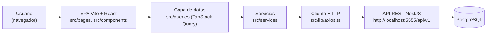
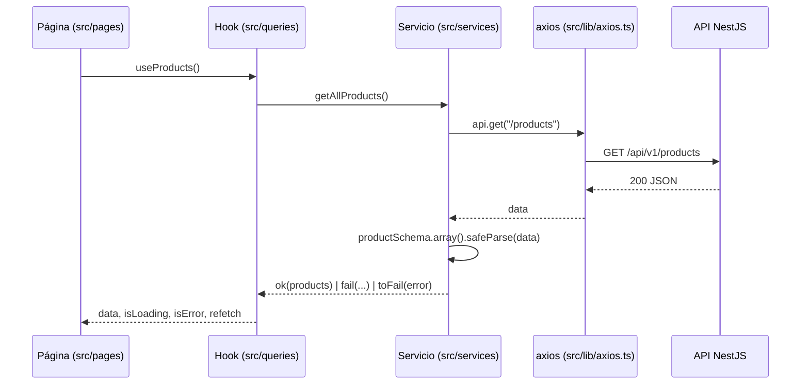

# Exhibition System — Frontend

Aplicación web (SPA) del proyecto **Exhibition System**: la interfaz de
gestión de **productos** y **categorías** (listar, ver, crear, editar y
desactivar) que consume la API REST del proyecto `backend/` (NestJS +
PostgreSQL) alojado en el mismo repositorio.

> [!NOTE]
> Este repositorio contiene dos proyectos pnpm independientes:
> `backend/` (API NestJS) y `frontend/` (esta SPA). Este documento
> describe únicamente el **frontend**. El backend se cubre como requisito
> de ejecución y como contrato de consumo.

## Tabla de contenidos

- [Descripción general](#descripción-general)
- [Stack tecnológico](#stack-tecnológico)
- [Estructura del proyecto](#estructura-del-proyecto)
- [Requisitos previos](#requisitos-previos)
- [Instalación](#instalación)
- [Variables de entorno y configuración](#variables-de-entorno-y-configuración)
- [Ejecución en desarrollo](#ejecución-en-desarrollo)
- [Ejecución en producción](#ejecución-en-producción)
- [Pruebas](#pruebas)
- [Linting y formateo](#linting-y-formateo)
- [API consumido](#api-consumido)
- [Arquitectura de la capa de datos](#arquitectura-de-la-capa-de-datos)
- [Rutas de la aplicación](#rutas-de-la-aplicación)
- [Convenciones del proyecto](#convenciones-del-proyecto)
- [Solución de problemas](#solución-de-problemas)
- [Licencia](#licencia)

## Descripción general

El frontend es una SPA en React que administra el catálogo de un sistema
de exhibición:

- **Productos** (`/products`): listado con búsqueda por nombre y filtro
  por categoría aplicados en el cliente, detalle, creación, edición y
  desactivación (borrado lógico).
- **Categorías** (`/categories`): listado, detalle, creación, edición y
  desactivación.
- **Inicio** (`/`): página de arquitectura que explica las capas del
  proyecto, el flujo de una petición y el stack por capa.

La aplicación no tiene backend propio ni base de datos: **toda la
persistencia vive en la API NestJS**, que corre por separado y expone
`/api/v1`. Sin esa API en ejecución, las pantallas muestran el estado de
error con opción de reintento.

Quién la usa: es un proyecto educativo de programación de software; la
interfaz existe para mostrar, de forma funcional, el flujo completo
navegador → SPA → API REST → base de datos.



## Stack tecnológico

Versiones declaradas en `frontend/package.json` (rangos de dependencia) y
confirmadas en `frontend/pnpm-lock.yaml`.

| Capa | Tecnología | Versión declarada | Propósito |
|---|---|---|---|
| UI | `react` / `react-dom` | `^19.2.8` | Render de la interfaz |
| Lenguaje | `typescript` | `~6.0.2` | Tipado estático (modo `noEmit`) |
| Build / dev server | `vite` | `^8.3.0` | Bundler y servidor de desarrollo |
| Plugin React | `@vitejs/plugin-react` | `^6.1.1` | Transformación JSX y Fast Refresh |
| Compilador | `babel-plugin-react-compiler` + `@rolldown/plugin-babel` | `^1.0.0` / `^0.2.3` | React Compiler activado vía preset de Babel en `vite.config.ts` |
| Enrutado | `react-router` | `^8.4.0` | `BrowserRouter` + rutas anidadas |
| Datos / caché | `@tanstack/react-query` | `^5.104.3` | Queries, mutations y caché del servidor |
| Datos / devtools | `@tanstack/react-query-devtools` | `^5.104.3` | Devtools de React Query (dependencia instalada) |
| Cliente HTTP | `axios` | `^1.20.0` | Cliente con interceptores de request/response |
| Validación | `zod` | `^4.6.7` | Schemas en `src/schemas/` y validación de respuestas |
| Formularios | `react-hook-form` + `@hookform/resolvers` | `^7.90.0` / `^5.9.1` | Formularios de producto y categoría |
| Estilos | `tailwindcss` + `@tailwindcss/vite` | `^4.3.3` | Tailwind CSS v4 (sin archivo de configuración) |
| Utilidades CSS | `clsx` + `tailwind-merge` | `^2.1.1` / `^3.7.0` | Composición de clases (`cn`) |
| Componentes | `@base-ui/react` | `^1.9.0` | Primitivas accesibles que usan los componentes `ui/` |
| Componentes (CLI) | `shadcn` | `^4.21.5` | Estilo `base-luma`, base color `mist` (`components.json`) |
| Iconos | `@remixicon/react` | `^4.9.0` | Iconografía (`iconLibrary: remixicon`) |
| Tipografías | `@fontsource-variable/eb-garamond`, `@fontsource-variable/noto-sans` | `^5.3.0` | Fuentes variables locales |
| Notificaciones | `sonner` | `^2.0.8` | Toasts (montados en `src/main.tsx`) |
| Animaciones | `motion` | `^14.3.0` | Transiciones de página, listados y tarjetas |
| Tema | `next-themes` | `^0.4.6` | Dependencia instalada; el modo oscuro se fija con `class="dark"` en `index.html` |
| Variantes | `class-variance-authority` | `^0.7.1` | Variantes de componentes `ui/` |
| Lint | `eslint` + `typescript-eslint` + `eslint-plugin-react-hooks` / `react-refresh` | `^10.10.0` / `^8.69.0` / `^7.1.1` / `^0.5.6` | Linting de TS/TSX (`eslint.config.js`) |
| Tipos (dev) | `@types/react`, `@types/react-dom`, `@types/node` | `^19.2.18` / `^19.2.7` / `^24.13.3` | Tipos de desarrollo |

> [!NOTE]
> `cn` aparece en `dependencies` (`^0.4.0`) porque `vite.config.ts` y
> `tsconfig.json` declaran un alias `cn` → `./src/lib/utils`. Los
> componentes importan `{ cn } from "cn"`, que resuelve al archivo local,
> no al paquete npm.

## Estructura del proyecto

```
frontend/
├── components.json            # Configuración de shadcn/ui (estilo base-luma)
├── eslint.config.js           # Configuración flat de ESLint
├── index.html                 # Shell HTML (monta #root y <html class="dark">)
├── package.json               # Manifiesto y scripts
├── pnpm-lock.yaml             # Lockfile (lockfileVersion '9.0')
├── public/                    # Assets estáticos servidos tal cual (vacío hoy)
├── src/
│   ├── App.tsx                # BrowserRouter que envuelve las rutas
│   ├── main.tsx               # Punto de entrada: Toaster, MotionConfig, QueryClientProvider
│   ├── index.css              # Tailwind v4 y variables de tema
│   ├── routes.tsx             # Declaración de rutas (anidadas bajo Layout)
│   ├── assets/                # Assets importados por el código (vacío hoy)
│   ├── components/
│   │   ├── category/          # Componentes del dominio categoría
│   │   ├── header/            # Barra de navegación global
│   │   ├── home/              # Secciones de la página de arquitectura
│   │   ├── product/           # Componentes del dominio producto
│   │   ├── ui/                # Componentes shadcn/ui (no editar a mano)
│   │   └── index.ts           # Barrel de componentes compartidos
│   ├── layouts/
│   │   └── _layout.tsx        # Layout raíz: Header + <Outlet/> con AnimatePresence
│   ├── lib/
│   │   ├── api-error-handler.ts  # Traduce ApiError a toasts de sonner
│   │   ├── axios.ts              # Instancia axios + interceptores + toFail
│   │   ├── constants.ts          # API_URL (origen del API)
│   │   ├── motion.ts             # Variantes y tokens de animación
│   │   └── utils.ts              # cn() y formatPrice()
│   ├── pages/
│   │   ├── categories/        # Listado, detalle, creación y edición
│   │   ├── home/              # Página de arquitectura del proyecto
│   │   ├── not-found/         # Página 404
│   │   └── products/          # Listado, detalle, creación y edición
│   ├── queries/
│   │   ├── api-error.ts       # Clase ApiError compartida
│   │   ├── query-client.ts    # QueryClient con la política de caché
│   │   ├── category/          # keys.ts, queries.ts, mutations.ts, index.ts
│   │   └── product/           # keys.ts, queries.ts, mutations.ts, index.ts
│   ├── schemas/
│   │   ├── category.schema.ts # Schemas Zod y tipos inferidos (categoría)
│   │   └── product.schema.ts  # Schemas Zod y tipos inferidos (producto)
│   ├── services/
│   │   ├── category.service.ts # Llamadas HTTP + validación Zod (categorías)
│   │   └── product.service.ts  # Llamadas HTTP + validación Zod (productos)
│   └── types/
│       ├── category.interface.ts         # Re-export de tipos del schema
│       ├── general-response.interface.ts # GeneralResponse, ok(), fail()
│       ├── product.interface.ts          # Re-export de tipos del schema
│       └── index.ts
├── tsconfig.json              # Proyecto de referencias + alias de rutas
├── tsconfig.app.json          # Configuración del código de la app
├── tsconfig.node.json         # Configuración de archivos de tooling (Vite)
└── vite.config.ts             # Plugins y aliases
```

## Requisitos previos

- **pnpm**: es el único gestor de paquetes permitido en el proyecto. El
  lockfile es `pnpm-lock.yaml` (`lockfileVersion: '9.0'`).
- **Node.js**: el repositorio **no** fija versión (no hay `engines` en
  `package.json`, ni `.nvmrc`, `.node-version` ni `.tool-versions`). La
  restricción real viene de las dependencias instaladas
  (`node_modules/<paquete>/package.json`):

  | Dependencia | Campo `engines.node` |
  |---|---|
  | `vite@8.3.4` | `^20.19.0 \|\| >=22.12.0` |
  | `react-router@8.4.0` | `>=22.22.0` |

  Por lo tanto, la versión de Node que satisface a todas las dependencias
  es **≥ 22.22.0**.

- **API del backend en ejecución**: la SPA consume
  `http://localhost:5555/api/v1`. Sin el backend levantado, las páginas
  muestran error de red. Consulta el `backend/README.md` y el `.env` del
  backend para su configuración.
- **Base de datos PostgreSQL** accesible por el backend (no por el
  frontend): es el backend quien la usa.

> [!IMPORTANT]
> El `frontend` fija el origen del API en el código
> (`src/lib/constants.ts`), así que el backend **debe** escuchar en el
> puerto `5555`. En `backend/.env.template` el valor de `PORT` es `3000`;
> si copias ese archivo a `backend/.env`, cámbialo a `5555` o la
> aplicación no podrá conectarse.

## Instalación

Todos los comandos se ejecutan **dentro de `frontend/`**. El gestor
permitido es `pnpm`.

```bash
# 1. Clonar el repositorio
git clone https://github.com/esteban5tael/proyecto-para-mostrar-sena
cd exhibition-system/frontend

# 2. Instalar dependencias exactas del lockfile
pnpm install

# 3. (Opcional pero necesario para usar la app) levantar el API del backend
cd ../backend
pnpm install
cp .env.template .env   # y ajustar PORT=5555
pnpm dev
```

Pasos recomendados del backend, en orden:

1. Copiar `backend/.env.template` a `backend/.env`. La plantilla trae
   `PORT=3000`, valores `DB_*` de ejemplo y un `JWT_SECRET` de ejemplo;
   ajusta `PORT=5555` y los datos reales de tu PostgreSQL.
2. Levantar el backend en modo watch con `pnpm dev` (dentro de `backend/`).
3. Opcional: sembrar datos de ejemplo con
   `curl -X POST http://localhost:5555/api/v1/seeders`. El seeder vacía las
   tablas y crea 5 categorías con 5 productos cada una (25 productos); solo
   para desarrollo.

> [!WARNING]
> No subas `backend/.env` al repositorio ni copies valores de secretos
> (`JWT_SECRET`, `DB_PASSWORD`) a documentación ni a commits. El
> `.env.template` versionado contiene valores de ejemplo, no utilices su
> `JWT_SECRET` en otros entornos.

## Variables de entorno y configuración

El frontend **no lee variables de entorno**: no existen archivos `.env` ni
`.env.example` dentro de `frontend/`, y una búsqueda de `import.meta.env`
o `process.env` en `src/` no devuelve resultados.

| Variable | Obligatoria | Valor por defecto | Descripción | Dónde se usa |
|---|---|---|---|---|
| — | — | — | No hay variables de entorno en el frontend | — |

El origen del API es una **constante en el código**, no una variable de
entorno:

```ts
// frontend/src/lib/constants.ts
export const API_URL = "http://localhost:5555/api/v1";
```

`API_URL` se consume como `baseURL` de la instancia axios en
`src/lib/axios.ts`. Para apuntar a otro backend hay que editar esa
constante (el proyecto no lee variables de entorno todavía).

## Ejecución en desarrollo

Scripts declarados en `frontend/package.json` (ejecutar dentro de
`frontend/`):

| Script | Comando real | Qué hace |
|---|---|---|
| `pnpm dev` | `vite` | Levanta el servidor de desarrollo con HMR. Muestra la URL en la terminal; `vite.config.ts` no fija `server.port`, así que se usa el puerto por defecto de Vite (`http://localhost:5173`, comportamiento externo al repositorio). |
| `pnpm build` | `tsc -b && vite build` | Chequeo de tipos con el modo build de TypeScript y luego el bundle de producción en `dist/`. |
| `pnpm lint` | `eslint .` | Analiza el proyecto con la configuración flat de `eslint.config.js`. |
| `pnpm preview` | `vite preview` | Sirve localmente el contenido ya construido en `dist/` para revisarlo antes de desplegar. |

Flujo típico de desarrollo:

```bash
# 1. Backend (en otra terminal, dentro de backend/)
pnpm dev

# 2. Sembrar datos de ejemplo (opcional, una sola vez)
curl -X POST http://localhost:5555/api/v1/seeders

# 3. Frontend (dentro de frontend/)
pnpm install
pnpm dev
```

> [!TIP]
> React Compiler está activado mediante el preset de Babel
> (`babel({ presets: [reactCompilerPreset()] })` en `vite.config.ts`). Eso
> es intencional y **ralentiza** `dev` y `build`; no es un problema de la
> máquina.

## Ejecución en producción

No hay Dockerfile, `docker-compose.yml`, `Makefile` ni pipeline de CI en
el repositorio: la construcción y el despliegue son manuales.

```bash
pnpm install --frozen-lockfile   # instalación reproducible desde el lockfile
pnpm build                       # genera frontend/dist/
pnpm preview                     # verificación local del bundle
```

`pnpm build` produce un sitio estático en `frontend/dist/` (un `index.html`
más assets con hash en `dist/assets/`). Al ser una SPA con rutas del lado
del cliente (`BrowserRouter`), el servidor que la publique debe redirigir
las rutas desconocidas a `index.html` para que funcione el refresco en
rutas como `/products/:id`.

> [!WARNING]
> El bundle generado incluye el origen del API fijado en
> `src/lib/constants.ts` (`http://localhost:5555/api/v1`). Un despliegue
> en otro host requiere editar esa constante y volver a construir.

## Pruebas

El frontend **no tiene framework de pruebas**: `package.json` no declara
un script `test` ni dependencias de test (Jest, Vitest, Testing Library o
similares), y no existen archivos `*.test.*` / `*.spec.*` en `src/`.

Los chequeos disponibles hoy son:

| Objetivo | Comando | Qué valida |
|---|---|---|
| Tipos | `pnpm build` (`tsc -b`) | Errores de TypeScript en `tsconfig.app.json`/`tsconfig.node.json` |
| Estilo/reglas | `pnpm lint` | Reglas de ESLint sobre todo el proyecto |
| Verificación manual | `pnpm dev` + backend | Flujos CRUD en el navegador |

## Linting y formateo

- **Linter**: ESLint `^10.10.0` (flat config) en `eslint.config.js`.
  Ignora `dist/` y aplica sobre `**/*.{ts,tsx}`: `js.configs.recommended`,
  `tseslint.configs.recommended`, `reactHooks.configs.flat.recommended` y
  `reactRefresh.configs.vite`, con globals de navegador.
- **Comando**: `pnpm lint`.
- **Formateo**: el frontend **no** incluye Prettier ni un script de
  formato, y el estilo del código no es homogéneo (por ejemplo,
  `src/main.tsx` usa comillas simples y `src/lib/axios.ts` usa comillas
  dobles). El proyecto backend sí usa Prettier (`pnpm format` dentro de
  `backend/`).

> [!NOTE]
> No existe un script `typecheck` separado: el chequeo de tipos ocurre
> dentro de `pnpm build` (`tsc -b && vite build`).

## API consumido

El frontend consume la API REST del backend en
`http://localhost:5555/api/v1` (`src/lib/constants.ts`). La fuente viva del
contrato es Swagger, expuesto por el backend en `/api/v1/docs`.

Endpoints usados, según `src/services/product.service.ts` y
`src/services/category.service.ts` (todas las rutas son relativas a
`API_URL`):

| Método | Ruta | Usado por | Descripción |
|---|---|---|---|
| `GET` | `/products` | `getAllProducts` | Listado de productos activos (con su categoría) |
| `GET` | `/products/:id` | `getProductById` | Detalle de un producto |
| `POST` | `/products` | `createProduct` | Crea un producto |
| `PATCH` | `/products/:id` | `updateProduct` | Actualiza parcialmente un producto |
| `DELETE` | `/products/:id` | `deleteProduct` | Desactiva un producto (`200` con `{ id, deleted: true }`) |
| `GET` | `/categories` | `getAllCategories` | Listado de categorías |
| `GET` | `/categories/:id` | `getCategoryById` | Detalle de una categoría |
| `GET` | `/categories/slug/:slug` | `getCategoryBySlug` | Detalle de una categoría por slug |
| `POST` | `/categories` | `createCategory` | Crea una categoría |
| `PATCH` | `/categories/:id` | `updateCategory` | Actualiza parcialmente una categoría |
| `DELETE` | `/categories/:id` | `deleteCategory` | Desactiva una categoría (respuesta `204` sin cuerpo) |

Encabezados y autenticación:

- `Content-Type: application/json` (valor fijo de la instancia axios).
- `timeout` de `10000` ms.
- Interceptor de request: si existe `localStorage.getItem("token")`, agrega
  `Authorization: Bearer <token>`.
- Interceptor de response: normaliza el error del backend a
  `{ statusCode, error, message, errors }`; en respuestas `401` elimina el
  token de `localStorage`. `toFail()` convierte ese error normalizado en
  `GeneralResponse<T>` (`sync`/`shape` estable para la UI).

> [!NOTE]
> El backend aplica `ValidationPipe` con `whitelist` y
> `forbidNonWhitelisted`: enviar un campo no declarado en el DTO rechaza la
> petición completa. Los formularios reflejan esas reglas en
> `src/schemas/`.

## Arquitectura de la capa de datos

Flujo de una lectura: la página usa un hook de `src/queries`, el hook llama
a un servicio de `src/services`, el servicio valida la respuesta con Zod y
convierte errores con `toFail`, y React Query cachea el resultado.



Piezas y responsabilidades:

- **`src/services/*.service.ts`**: única puerta al API. Cada función hace
  la petición, valida la respuesta con el schema Zod del dominio y
  devuelve `GeneralResponse<T>` (`{ success, statusCode, message,
  errors }`). Nunca lanza por errores HTTP: los convierte con `toFail()`.
- **`src/queries/<dominio>/keys.ts`**: factory de query keys tipadas. Todas
  derivan de `<dominio>Keys.all` para poder invalidar el dominio completo
  con una sola llamada.
- **`src/queries/<dominio>/queries.ts`**: hooks `useQuery` (`useProducts`,
  `useProduct`, `useCategories`, `useCategory`, `useCategoryBySlug`). Si el
  servicio devuelve `success: false`, lanzan `ApiError` para que React
  Query gestione el error.
- **`src/queries/<dominio>/mutations.ts`**: hooks `useMutation`
  (`useCreateProduct`, `useUpdateProduct`, `useDeleteProduct` y los
  equivalentes de categoría). Invalidan el dominio completo en `onSuccess`
  y delegan en el consumidor la navegación y los toasts.
- **`src/queries/api-error.ts`**: clase `ApiError` (con `statusCode` y
  `errors`) que transporta los errores de validación del backend.
- **`src/lib/api-error-handler.ts`**: `handleApiError(err, fallback)`
  traduce `ApiError` a toasts de `sonner` (varios errores de validación se
  muestran como lista).
- **`src/queries/query-client.ts`**: `QueryClient` con `staleTime` de 5
  minutos, `refetchOnMount: true`, `refetchOnWindowFocus` desactivado,
  `retry: 0` en mutations.

Formularios y validación:

- Los schemas viven en `src/schemas/` (`product.schema.ts`,
  `category.schema.ts`) y son la **única fuente de verdad** de los tipos
  `Product`, `Category`, `CreateProductDto`, `UpdateProductDto`,
  `CreateCategoryDto` y `UpdateCategoryDto`, que se infieren con
  `z.infer`. `src/types/*.interface.ts` solo re-exporta esos tipos.
- Las reglas del frontend replican las del backend (por ejemplo, máximo de
  dos decimales en `price`, `categoryId` como UUID, `slug` con patrón
  kebab-case).
- Las respuestas del servidor también se validan: un payload inesperado se
  reporta como `500` con "Respuesta del servidor no válida" y el detalle
  de los issues.

## Rutas de la aplicación

Declaradas en `src/routes.tsx` con `Routes`/`Route` de React Router, todas
anidadas bajo `src/layouts/_layout.tsx` (Header + `<Outlet/>` animado):

| Ruta | Página | Descripción |
|---|---|---|
| `/` | `src/pages/home/home.page.tsx` | Página de arquitectura del proyecto |
| `/products` | `src/pages/products/products-list.tsx` | Listado, búsqueda y filtro por categoría |
| `/products/create` | `src/pages/products/product-create.tsx` | Formulario de creación |
| `/products/:id` | `src/pages/products/product-view.tsx` | Detalle del producto |
| `/products/:id/edit` | `src/pages/products/product-edit.tsx` | Edición del producto |
| `/categories` | `src/pages/categories/categories-list.tsx` | Listado de categorías |
| `/categories/create` | `src/pages/categories/category-create.tsx` | Formulario de creación |
| `/categories/:id` | `src/pages/categories/category-view.tsx` | Detalle de la categoría |
| `/categories/:id/edit` | `src/pages/categories/category-edit.tsx` | Edición de la categoría |
| `*` | `src/pages/not-found/not-found.tsx` | Página 404 |

## Convenciones del proyecto

- **Gestor de paquetes**: solo `pnpm` (nunca `npm` ni `yarn`); el lockfile
  versionado es `pnpm-lock.yaml`.
- **Nombres de archivo**: kebab-case (`product-card.tsx`,
  `product.schema.ts`); un componente por archivo y barrels `index.ts` por
  carpeta.
- **Aliases**: `@` → `src` y `cn` → `src/lib/utils`, definidos en
  `vite.config.ts`, `tsconfig.json` y `tsconfig.app.json`.
- **JSDoc en español**: obligatorio en módulos, funciones, interfaces y
  clases; los comentarios inline explican el porqué.
- **Commits**: formato convencional en español, por ejemplo
  `feat(categories): agrega CRUD completo en frontend`.
- **Estado**: los datos del servidor viven en TanStack Query; el estado de
  UI (búsqueda, filtros, diálogos) se maneja con `useState`/`useMemo` en las
  páginas. No hay store global (Zustand/Redux) en el proyecto.
- **Componentes `ui/`**: generados por shadcn/ui sobre `@base-ui/react`
  (estilo `base-luma`, base color `mist`); no se editan a mano salvo
  necesidad justificada.

## Solución de problemas

| Síntoma | Causa probable | Solución |
|---|---|---|
| Las páginas muestran error de red o "Error inesperado" | El backend no está levantado en el puerto 5555 | Arranca el backend (`pnpm dev` dentro de `backend/`) y confirma que `backend/.env` tiene `PORT=5555`, que es el valor fijado en `src/lib/constants.ts` |
| El backend arranca en `:3000` y el frontend no conecta | Se copió `backend/.env.template`, que trae `PORT=3000` | Edita `backend/.env` y pon `PORT=5555` |
| No hay datos en los listados | Base de datos vacía | Ejecuta `POST /api/v1/seeders` (`curl -X POST http://localhost:5555/api/v1/seeders`) para sembrar 5 categorías × 5 productos |
| `pnpm build` o `pnpm dev` fallan al instalar/iniciar | Versión de Node anterior a la exigida | Verifica `node -v`; las dependencias instaladas exigen `>= 22.22.0` |
| Aviso de que `pnpm-lock.yaml` no coincide | Instalación con `npm`/`yarn` | Borra `node_modules` y reinstala con `pnpm install` (el proyecto solo versiona `pnpm-lock.yaml`) |
| `pnpm lint` reporta `dist/` | Se ejecutó el linter sobre artefactos generados | No es necesario: `eslint.config.js` ya ignora `dist/`; revisa que no haya copias de configuración |
| Pantalla en blanco tras recargar en `/products/...` en un despliegue | El servidor de hosting no redirige a `index.html` | Configura fallback SPA (todas las rutas → `index.html`) |

